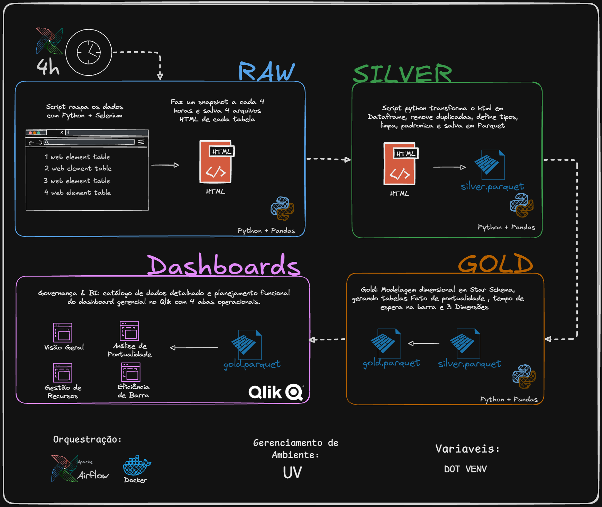
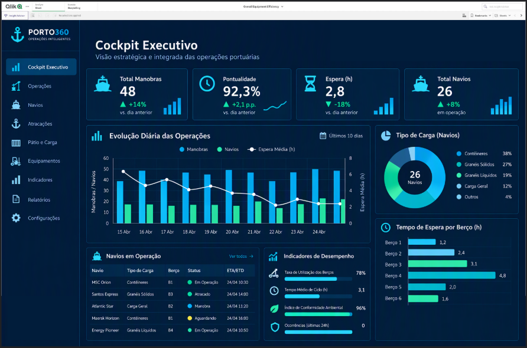
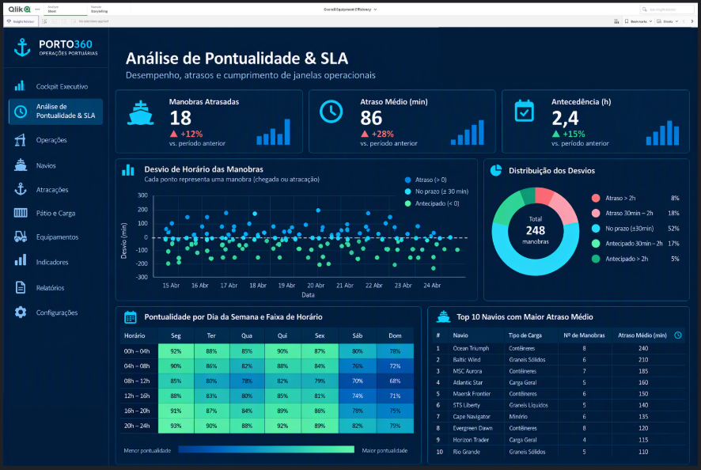
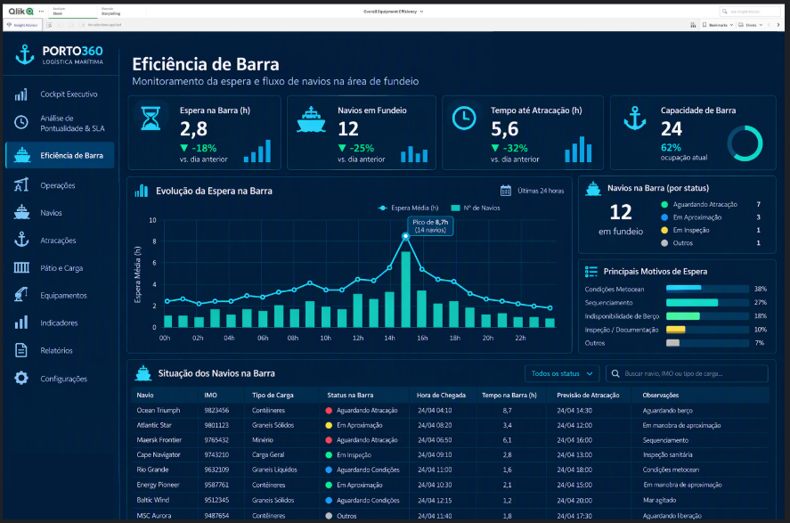
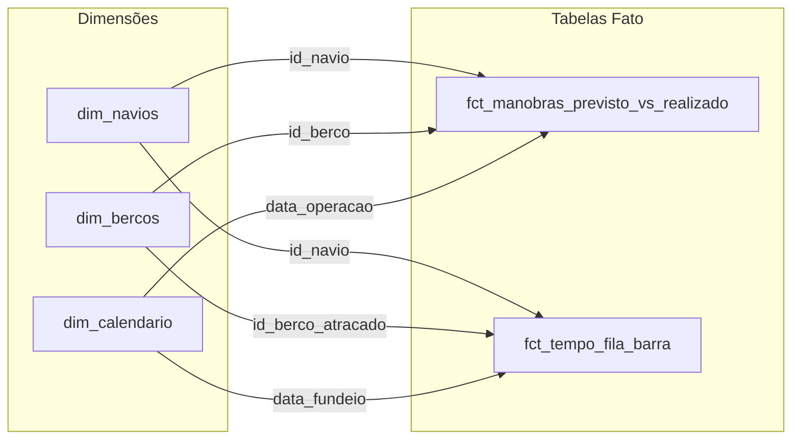

# Marítimo Data Pipeline — Operações Portuárias (Selenium + Pandas + Airflow + Qlik)


Pipeline de dados de ponta a ponta que coleta, trata, modela e organiza informações operacionais de um porto — **manobras previstas, manobras realizadas, navios atracados, navios fundeados e chegadas previstas** — transformando páginas HTML voláteis em um **Star Schema** pronto para análise de pontualidade (SLA) e eficiência de barra.

O pipeline faz **Web Scraping com Selenium**, normaliza os dados na camada **Silver** com Python/pandas (gerando **Apache Parquet**), estrutura a camada **Gold** em **Modelagem Dimensional (Star Schema)**, é **orquestrado pelo Apache Airflow** (Docker, no homelab) e alimenta um **dashboard gerencial no Qlik** com 5 abas operacionais.

> **Documentação e aprendizados:**
>
> * [catalogo_de_dados.md](catalogo_de_dados.md) — **Catálogo oficial e dicionário de dados**: esquemas, tipos, métricas de negócio e o mapa completo do dashboard.
> * [aprendizados.md](aprendizados.md) — decisões técnicas, desafios arquiteturais e boas práticas de engenharia de dados adotadas.
> * [orquestracao/](orquestracao/) — DAGs do Airflow, script de disparo via cron e a documentação da camada de orquestração.

---

## Contexto do Projeto

**Problema:** os dados operacionais do porto só existem como **tabelas HTML em uma página web**, que são sobrescritas ao longo do dia. Isso traz três dificuldades:

* **Sem histórico:** a página mostra só o estado atual; não dá para analisar atrasos, tendências ou comparar dias.
* **Dado sujo e volátil:** texto com acentos, horários como `"16:45 atb"` ou `"TBC"`, campos nulos e múltiplos formatos de data.
* **Previsto ≠ Realizado:** a mesma manobra aparece várias vezes com previsões diferentes ao longo do tempo, sem um registro consolidado do que de fato aconteceu.

**Objetivo:** construir um pipeline que:

* Captura **snapshots periódicos** (a cada 4h) e preserva o dado bruto para auditoria.
* Limpa, tipa e normaliza as 5 tabelas na camada **Silver** (Parquet).
* Consolida tudo em um **Star Schema** na camada **Gold**, deduplicando snapshots e cruzando **previsto vs. realizado**.
* Calcula métricas de negócio: **taxa de pontualidade**, **atraso em minutos**, **tempo de espera na barra**.

**Resultado:** um modelo dimensional com **2 tabelas Fato e 3 Dimensões**, orquestrado e automatizado, pronto para consumo em BI.

---

## Arquitetura Medalhão

A imagem abaixo resume o fluxo completo nas camadas **Raw → Silver → Gold → Dashboards**:



```text
Fonte de Dados Portuária (Web)
            │
   Web Scraping — Selenium  (cron do host, a cada 4h)
            │
  Landing Raw — HTML Bruto (snapshots)
            │
  [ cron dispara a DAG do Airflow: docker exec ... dags trigger ]
            │
  ┌───────────── Apache Airflow (Docker) ─────────────┐
  │  DAG maritimo_transform                            │
  │  transform_silver.py  ──▶  transform_gold.py       │
  │  (HTML → Parquet)          (→ Star Schema)         │
  └────────────────────────────────────────────────────┘
            │
  Silver — Parquet normalizado e tipado
            │
  Gold — Parquets dimensionais (Fatos e Dimensões)
            │
  Dashboard Executivo & Operacional — Qlik Sense / Cloud
```

### 1. Landing Raw (`landing_raw/`)

* Snapshots HTML brutos coletados via Selenium, nomeados `YYYY-MM-DD_HH-MM-SS_<tabela>.html`.
* Preserva o dado original para auditoria e permite **reprocessamento completo** do pipeline.

### 2. Camada Silver (`silver/`)

* Normalização e limpeza de texto (remoção de acentos, `snake_case`).
* Extração e unificação de datas/horas operacionais (`data_hora_*`), tipadas como `datetime64[us]`.
* Conversão colunar para **Apache Parquet**; tipagem defensiva contra nulos e horários suspensos (`TBC`).
* **Idempotente:** só processa o HTML que ainda não virou Parquet.

### 3. Camada Gold (`gold/`)

* Consolidação e deduplicação de múltiplos snapshots em um Star Schema limpo.
* **Dimensões:** `dim_navios`, `dim_bercos` (com terminal operador) e `dim_calendario`.
* **Fatos:** `fct_manobras_previsto_vs_realizado` (atraso em minutos e classificação de pontualidade) e `fct_tempo_fila_barra` (tempo de espera no fundeio).

---

## 📊 Dashboards (Qlik — PORTO360)

A camada de visualização foi planejada no [catálogo de dados](catalogo_de_dados.md) com **5 abas operacionais**. Abaixo, protótipos das telas construídas sobre o Star Schema da camada Gold.

### Cockpit Executivo & Análise de Pontualidade (SLA)



Auditoria do cumprimento da grade de programação: **manobras atrasadas**, **atraso médio (min)** e **antecedência da previsão (h)**, com dispersão dos desvios de horário, distribuição de pontualidade (No Prazo / Atrasado / Adiantado), heatmap de pontualidade por dia da semana × faixa de horário e ranking dos navios com maior atraso médio.



### Eficiência de Barra & Fila de Fundeio



Monitoramento da espera e do fluxo de navios na área de fundeio: **tempo médio de espera na barra**, **navios em fundeio**, **tempo até atracação** e **ocupação da barra**, com a evolução temporal da espera (destacando picos de barra fechada), os principais motivos de espera e a grade operacional dos navios aguardando no fundeio.

> As demais abas (Visão Geral, Gestão de Recursos de Rebocadores & Frota, Detalhamento/Auditoria) estão especificadas em detalhe — KPIs, dimensões e memória de cálculo — na **Parte 3** do [catalogo_de_dados.md](catalogo_de_dados.md).

---

## Modelagem Dimensional (Star Schema)




| Tabela                               | Tipo      | Papel                                                               |
| :------------------------------------- | :---------- | :-------------------------------------------------------------------- |
| `dim_navios`                         | Dimensão | Cadastro único de embarcações (LOA, Boca).                       |
| `dim_bercos`                         | Dimensão | Berços + mapeamento do terminal operador.                          |
| `dim_calendario`                     | Dimensão | Tempo contínuo (ano, mês, trimestre, dia da semana).              |
| `fct_manobras_previsto_vs_realizado` | Fato      | Previsto vs. realizado: atraso em minutos e status de pontualidade. |
| `fct_tempo_fila_barra`               | Fato      | Tempo de espera (horas) do fundeio até a atracação.              |

---

## Tecnologias Utilizadas


| Ferramenta                   | Uso                                                         |
| :----------------------------- | :------------------------------------------------------------ |
| **Python 3.12**              | Linguagem principal do pipeline.                            |
| **Selenium WebDriver**       | Coleta (scraping) das tabelas HTML.                         |
| **pandas / PyArrow / NumPy** | Transformação, tipagem e escrita em Parquet.              |
| **Apache Parquet**           | Armazenamento colunar das camadas Silver e Gold.            |
| **Star Schema**              | Modelagem dimensional (Fatos + Dimensões).                 |
| **Apache Airflow 3.3.2**     | Orquestração da DAG`maritimo_transform` (silver → gold). |
| **Docker / Docker Compose**  | Infra do Airflow no homelab (LocalExecutor + Postgres).     |
| **cron (host)**              | Agendamento desacoplado que dispara a DAG.                  |
| **uv**                       | Gerenciamento de ambiente e dependências.                  |
| **Markdown / Mermaid**       | Data Documentation as Code (catálogo e diagramas).         |
| **Qlik Sense / Qlik Cloud**  | Consumo e visualização (BI).                              |

---

## Estrutura do Projeto

```text
maritimo-data-pipeline/
├── .gitignore                     # Protege dados brutos, Parquets e segredos (.env)
├── LICENSE
├── README.md
├── pyproject.toml                 # Dependências do projeto (uv)
├── uv.lock
│
├── scraper.py                     # Etapa 1: scraping com Selenium → landing_raw/
├── transform_silver.py            # Etapa 2: HTML → Parquet (Silver), idempotente
├── transform_gold.py              # Etapa 3: Silver → Star Schema (Gold)
│
├── catalogo_de_dados.md           # Catálogo e dicionário de dados (contrato Eng. ↔ BI)
├── aprendizados.md                # Decisões técnicas e lições aprendidas
│
├── landing_raw/                   # Snapshots HTML brutos (+ exemplos versionados)
├── silver/                        # Parquets normalizados por tabela (+ *_example.parquet)
├── gold/                          # Parquets dimensionais (+ *_example.parquet)
│
├── asset/                         # Diagrama de arquitetura
│   └── arq-maritimo-data-papiline.png
├── dashboard/                     # Protótipos das telas do Qlik (PNG)
│   ├── dash1.png
│   ├── dash2.png
│   └── dash3.png
│
└── orquestracao/                  # Camada de orquestração (Airflow)
    ├── README.md
    ├── dags/
    │   └── maritimo_transform.py  # DAG principal: silver >> gold
    └── scriptcron/
        ├── trigger_airflow_transform.sh
        └── crontab.example
```

> Os arquivos `*_example` são amostras controladas e versionadas para que o pipeline possa ser testado sem o dado real (que fica fora do Git).

---

## Orquestração com Apache Airflow

As transformações (silver → gold) rodam na DAG **`maritimo_transform`**, em containers Docker no homelab. Decisões de arquitetura em resumo:

* **Airflow 3.3.2 com LocalExecutor + Postgres** — leve para os recursos do homelab (sem Redis/Celery). O Postgres guarda só os metadados do Airflow.
* **Agendamento no cron do host, não no Airflow** (`schedule=None`). A coleta (Selenium) depende de site externo e roda no host; o cron dispara a DAG via `docker exec`, de forma **desacoplada**. Se a coleta falhar, a transformação simplesmente não acha dado novo — em vez de a DAG quebrar por falta de insumo.
* **Idempotência:** a DAG só processa os HTML que ainda não viraram Parquet, então disparar sem dado novo é inofensivo.
* **Validações explícitas:** a task de silver falha se a camada ficar vazia; a de gold confirma que todos os artefatos esperados do Star Schema foram gerados.

Detalhes completos (incluindo o script de cron e as explicações sobre volumes no Docker) estão no [README da orquestração](orquestracao/README.md).

---

## Como Reproduzir

### Pré-requisitos

* Python 3.12 e [uv](https://docs.astral.sh/uv/) instalados.
* Google Chrome / Chromium (para o Selenium).
* (Opcional) Docker + Docker Compose, para rodar a orquestração.

### 1. Instalar as dependências

```bash
uv sync
```

### 2. Configurar o `.env`

Crie um arquivo `.env` na raiz com a URL da fonte de dados:

```env
URL_DATA1=https://exemplo-do-porto/operacoes
```

> O `.env` está no `.gitignore` e **não deve ser versionado**.

### 3. (Opcional) Coletar um snapshot

```bash
uv run python scraper.py
```

O repositório já traz exemplos em `landing_raw/*_example.html`, então é possível testar as transformações sem rodar o scraper.

### 4. Rodar as transformações

```bash
# Landing Raw (HTML) → Silver (Parquet)
uv run python transform_silver.py

# Silver (Parquet) → Gold (Star Schema)
uv run python transform_gold.py
```

### 5. (Opcional) Orquestrar com Airflow

Suba o ambiente do Airflow (Docker) e dispare a DAG — ver [orquestracao/](orquestracao/):

```bash
docker exec airflow-scheduler airflow dags trigger maritimo_transform
```

### 6. Conectar o Qlik

Aponte o Qlik Sense / Qlik Cloud para os Parquets da camada `gold/` e construa os visuais conforme o mapa do dashboard no [catálogo de dados](catalogo_de_dados.md).

---

## Lições Aprendidas

Detalhadas em [aprendizados.md](aprendizados.md). Em resumo:

* **DRY na Silver:** uma função genérica + um dicionário de regras por tabela, em vez de 5 scripts quase idênticos.
* **Idempotência:** reprocessar só o que falta torna o disparo da DAG seguro e barato.
* **Documentation as Code:** catálogo em Markdown + diagramas Mermaid versionam a documentação junto com o código, evitando *documentation drift*.
* **Decisões conscientes:** Selenium foi escolhido por objetivo de aprendizado, mesmo reconhecendo que `requests`/`BeautifulSoup` seriam mais leves para HTML estático.

---

## Próximos Passos

* [ ]  Conectar o Qlik aos Parquets da Gold e publicar o dashboard.
* [ ]  Testes automatizados para as funções de transformação.
* [ ]  Monitoramento/alertas de falha na coleta.
* [ ]  Refatorar o scraping com `requests`/`BeautifulSoup` (mais leve para o HTML estático).
* [ ]  Avaliar migração do armazenamento para a nuvem.
